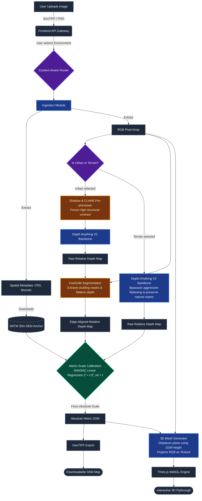

# DepthWizard Pipeline Flowchart & Walkthrough

This document maps out the complete end-to-end data flow for the prototype, detailing every step from a user uploading an image to rendering the final 3D flythrough. It explicitly includes the context-aware routing and "band-aid" solutions we established to guarantee a flawless presentation.

---

## 1. System Architecture Flowchart

---

## 2. Step-by-Step Pipeline Walkthrough

### Phase 1: Ingestion & Metadata Extraction
1. **Upload:** The user drags and drops a curated satellite image into the Web UI and specifically toggles the Environment setting (Urban vs. Terrain).
2. **Parsing:** The FastAPI backend uses `rasterio` to parse the image. If it is a GeoTIFF, it extracts the Bounding Box coordinates, spatial resolution (GSD), and EPSG code. The raw image is converted into a standard RGB NumPy array.

### Phase 2: Context-Aware Routing
3. **The Fork:** The pipeline intelligently decides its execution path based on the user's environment toggle. This was introduced to solve the "Minecraft Canyon" effect, where urban algorithms destroyed the smooth gradients of natural mountains.

### Phase 3: The Urban Pathway (Buildings & Cities)
4. **Pre-Processing (Band-Aid 1):** The RGB array undergoes CLAHE (Contrast Limited Adaptive Histogram Equalization) and HSV shadow enhancement to force distinct edge boundaries between roofs and the ground.
5. **Inference:** The processed image is passed through the pre-trained `Depth Anything V2` backbone to generate a raw relative depth map.
6. **Segmentation Flattening (Band-Aid 2):** Because the model can blur building edges into the ground, we run `FastSAM` (Segment Anything). FastSAM detects individual building footprints (masks) and mathematically flattens the depth values inside each mask. This forces razor-sharp, blocky 3D structures.

### Phase 4: The Terrain Pathway (Mountains & Valleys)
7. **Bypass Mode:** If Terrain is selected, the pipeline *entirely bypasses* the Pre-processing and FastSAM modules.
8. **Direct Inference:** The raw, unaltered RGB image is fed directly into `Depth Anything V2`. This preserves the AI's ability to predict smooth, sweeping, continuous topographical slopes without artificially flattening them.

### Phase 5: Metric Scale Calibration (The Complete Fix)
9. **Anchor Fetching:** Using the bounding box from Phase 1, the system pings an open API (like OpenTopography) to download the low-resolution SRTM 30m DEM for that exact geographic square.
10. **RANSAC Regression:** The system mathematically matches the high-res relative depth (from either the Urban or Terrain pathway) to the low-res metric SRTM data, calculating exactly how many meters `0.0` and `1.0` represent. It applies this linear formula ($Z = s \cdot Z_{rel} + t$) to output a true **Absolute Metric DSM**.

### Phase 6: 3D Generation & Flythrough
11. **Mesh Generation:** A highly subdivided 3D plane is generated. The Metric DSM dictates the exact Z-axis displacement (height) of every vertex on that plane.
12. **Texturing:** The original optical RGB image is draped over this 3D mesh as a texture.
13. **Rendering:** The mesh is streamed back to the frontend UI, loaded into `Three.js`, and the user is dropped into an interactive, first-person drone camera to fly through the newly generated metric landscape.
