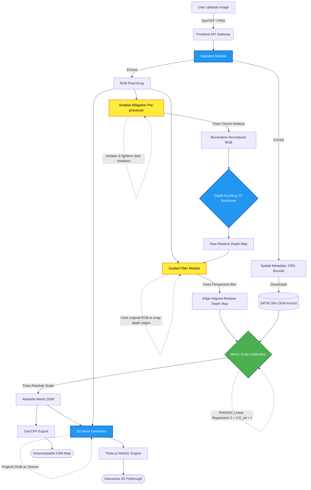

# DepthWizard Pipeline Flowchart & Walkthrough

This document maps out the complete end-to-end data flow for the prototype, detailing every step from a user uploading an image to rendering the final 3D flythrough. It explicitly includes the pre-processing and post-processing "band-aid" solutions we established to guarantee a flawless presentation.

---

## 1. System Architecture Flowchart

---

## 2. Step-by-Step Pipeline Walkthrough

### Phase 1: Ingestion & Metadata Extraction
1. **Upload:** The user drags and drops a curated satellite image into the Web UI.
2. **Parsing:** The FastAPI backend uses `rasterio` to parse the image. If it is a GeoTIFF, it extracts the Bounding Box coordinates, spatial resolution (GSD), and EPSG code. The raw image is converted into a standard RGB NumPy array.

### Phase 2: Pre-Processing (Band-Aid 1 - Shadow Mitigation)
3. **Shadow Masking:** Before the model sees the image, we convert the RGB array to HSV color space to isolate dark shadow regions.
4. **Equalization:** We artificially lighten these shadows to match the surrounding ground albedo. 
   > *Why?* This prevents Depth Anything V2 from seeing shadows as deep physical holes ("trench" artifacts).

### Phase 3: Monocular Depth Inference
5. **Inference:** The shadow-corrected RGB image is passed through the pre-trained `Depth Anything V2` backbone.
6. **Raw Output:** The model outputs a high-resolution, but relative and slightly blurry, depth map scaled between 0 and 1.

### Phase 4: Post-Processing (Band-Aid 2 - Edge Snapping)
7. **Guided Filtering:** We apply a mathematical Guided Filter to the raw depth map. We use the *original, unedited RGB image* as the structural guide.
   > *Why?* Because the model expects ground-level perspective, top-down building edges can blur into the ground (Domain Shift). The Guided Filter forces the blurry depth map edges to instantly snap to the razor-sharp physical edges visible in the original RGB image.

### Phase 5: Metric Scale Calibration (The Complete Fix)
8. **Anchor Fetching:** Using the bounding box from Phase 1, the system pings an open API (like OpenTopography) to download the low-resolution SRTM 30m DEM for that exact geographic square.
9. **RANSAC Regression:** The system mathematically matches the high-res relative depth to the low-res metric SRTM data, calculating exactly how many meters `0.0` and `1.0` represent. It applies this formula ($Z = s \cdot Z + t$) to output a true **Absolute Metric DSM**.
   > *Why?* This solves the core limitation of zero-shot models having no concept of physical scale.

### Phase 6: 3D Generation & Flythrough
10. **Mesh Generation:** A highly subdivided 3D plane is generated. The Metric DSM dictates the exact Z-axis displacement (height) of every vertex on that plane.
11. **Texturing:** The original optical RGB image is draped over this 3D mesh as a texture.
12. **Rendering:** The mesh is streamed back to the frontend UI, loaded into `Three.js`, and the user is dropped into an interactive, first-person drone camera to fly through the newly generated metric landscape.
