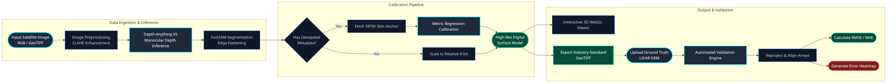

# DepthWizard 🛰️

> **ISRO Hackathon 2025 — Problem Statement #26175**  
> Theme: Disaster Management | Organisation: Space Applications Centre (SAC), ISRO

**DepthWizard** is a single-view height estimation and interactive 3D flythrough system that transforms ordinary satellite/aerial RGB imagery into metric-scale Digital Surface Models (DSMs) and immersive WebGL terrain flythroughs — no stereo pairs, no LiDAR required.



---

## ✨ What It Does

| Input | Output |
|---|---|
| Non-georeferenced RGB (`.png`, `.jpg`) | Relative DSM (`.tiff`) + 3D mesh + flythrough |
| Georeferenced GeoTIFF (`.tif`, `.geotiff`) | **Absolute metric DSM** (`.geotiff`) calibrated against SRTM 30m + flythrough |

The pipeline runs **fully locally** (CPU or CUDA GPU), with automatic VRAM swapping to prevent OOM.

---

## 🏗️ Architecture

```
Satellite/Aerial Image
        │
        ▼
 ┌──────────────────┐
 │  Ingestion Layer │  rasterio + OpenCV — parses CRS, bounds, GSD
 └────────┬─────────┘
          │
          ▼
 ┌──────────────────┐
 │  Preprocessing   │  CLAHE contrast enhancement + shadow deepening
 └────────┬─────────┘   (urban mode only)
          │
          ▼
 ┌──────────────────────────────────┐
 │  MDE Engine: Depth Anything V2   │  PyTorch — VRAM-swap aware inference
 └────────┬─────────────────────────┘
          │
          ▼
 ┌──────────────────┐
 │   Segmentation   │  FastSAM / MobileSAM — edge flattening on instances
 └────────┬─────────┘   (urban mode only)
          │
          ▼
 ┌──────────────────────────────────┐
 │  SRTM Calibration Engine         │  RANSAC linear regression  Z = s·Z_rel + t
 └────────┬─────────────────────────┘   (georeferenced images only)
          │
     ┌────┴────┐
     ▼         ▼
GeoTIFF    3D Mesh JSON  ─── served to Three.js WebGL frontend
 Export      Export
```

### Backend Modules (`src/depth_wizard/`)

| Module | Responsibility |
|---|---|
| `api.py` | FastAPI gateway — orchestrates the full pipeline, exposes `/api/process` & `/api/validate` |
| `ingestion.py` | Loads RGB images via rasterio/OpenCV, extracts geospatial metadata, enforces 2048px cap |
| `preprocessing.py` | CLAHE (LAB colour space) + percentile-based shadow enhancement |
| `model.py` | Depth Anything V2 wrapper with on-demand VRAM load/unload |
| `segmentation.py` | FastSAM/MobileSAM inference + per-mask depth flattening |
| `calibration.py` | SRTM DEM fetching + RANSAC scale-shift regression |
| `export.py` | GeoTIFF export (rasterio), JSON mesh export, JPEG texture export |
| `validation.py` | RMSE / MAE / R² computation against GT LiDAR; error heatmap rendering |

### Frontend (`frontend/`)

Three.js WebGL terrain renderer served as static files by FastAPI:

- **Orbit Camera** — free 360° rotation around the terrain
- **Drone Flythrough** — WASD + mouse FPS controls with physics (altitude hold, pitch/roll tilt)
- **Layer Toggles** — Optical RGB | Elevation DSM colourmap | Validation Error Heatmap
- **Point Inspector** — hover/click any vertex → elevation (Z), slope (°), XY coordinates
- **Interaction Log Ledger** — real-time event audit log, exportable as JSON

---

## ⚙️ Requirements

| Requirement | Version |
|---|---|
| Python | ≥ 3.13 |
| uv (package manager) | ≥ 0.4.0 |
| CUDA (optional) | ≥ 12.0 (CPU fallback available) |
| RAM | ≥ 8 GB |
| VRAM | ≥ 4 GB (GPU inference) |

---

## 🚀 Quick Start

### 1. Clone the repository

```bash
git clone https://github.com/AdiGoCrazy/depth-wizard.git
cd depth-wizard
```

### 2. Run the setup script

```bash
chmod +x setup.sh
./setup.sh
```

The script will:
1. Check Python 3.13+ is available
2. Install `uv` if missing
3. Sync all dependencies into a `.venv`
4. Copy `.env.example` → `.env` (edit for your API keys)
5. Create the asset storage directory

### 3. (Optional) Configure your environment

```bash
# Edit .env to set your OpenTopography API key for higher SRTM rate limits
nano .env
```

Key variables:

```dotenv
HOST=0.0.0.0
PORT=8000
OPENTOPOGRAPHY_API_KEY=your_key_here   # Optional — increases SRTM rate limit
ASSET_STORAGE_DIR=/tmp/depthwizard_exports/
LOG_LEVEL=INFO
```

### 4. (Optional) Download model weights locally

By default the backend downloads **Depth Anything V2 Large** from HuggingFace Hub on first run. To pre-cache it locally for offline use:

```bash
# Large model (~1.35 GB) — best quality
uv run python -c "
from transformers import pipeline
pipe = pipeline('depth-estimation', model='depth-anything/Depth-Anything-V2-Large-hf')
pipe.save_pretrained('models/depth_anything_v2_large')
print('Model cached to models/depth_anything_v2_large')
"
```

### 5. Start the server

```bash
uv run uvicorn depth_wizard.api:app --host 0.0.0.0 --port 8000 --reload
```

Open **http://localhost:8000** in your browser.

---

## 📡 API Reference

### `POST /api/process`

Process a satellite image through the full depth estimation pipeline.

**Form fields:**

| Field | Type | Description |
|---|---|---|
| `file` | binary | Image file (`.tif`, `.geotiff`, `.png`, `.jpg`, `.jpeg`) — max 20 MB |
| `environment` | string | `"urban"` (enables CLAHE + SAM segmentation) or `"terrain"` (raw MDE only) |

**Response:**

```json
{
  "status": "success",
  "job_id": "uuid-string",
  "is_metric": true,
  "dsm_url": "/assets/<job_id>_dsm.tif",
  "mesh_url": "/assets/<job_id>_mesh.json",
  "texture_url": "/assets/<job_id>_texture.jpg",
  "metrics": {
    "rmse": 12.4,
    "mae": 8.7,
    "r2_score": 0.94
  }
}
```

`is_metric` is `true` only when the input was a valid GeoTIFF with CRS and SRTM calibration succeeded.

---

### `POST /api/validate`

Compare the predicted DSM against a ground-truth LiDAR file.

**Form fields:**

| Field | Type | Description |
|---|---|---|
| `file` | binary | Ground-truth GeoTIFF (LiDAR DSM) |
| `job_id` | string | Job ID returned by `/api/process` |

**Response:**

```json
{
  "status": "success",
  "rmse": 5.2,
  "mae": 3.8,
  "heatmap_url": "/assets/<job_id>_heatmap.jpg"
}
```

---

## 🧪 Running Tests

```bash
# Full test suite
uv run pytest -v -s

# Individual modules
uv run pytest tests/test_ingestion.py -v
uv run pytest tests/test_calibration.py -v
uv run pytest tests/test_preprocessing.py -v
uv run pytest tests/test_api.py -v

# Integration test (requires running server)
uv run python tests/run_integration.py
```

---

## 📂 Project Structure

```
depth-wizard/
├── src/
│   └── depth_wizard/         # Backend Python package
│       ├── api.py            # FastAPI app & endpoint orchestration
│       ├── ingestion.py      # Image loading & geospatial metadata parsing
│       ├── preprocessing.py  # CLAHE + shadow enhancement
│       ├── model.py          # Depth Anything V2 inference engine
│       ├── segmentation.py   # FastSAM/MobileSAM instance segmentation
│       ├── calibration.py    # SRTM RANSAC metric calibration
│       ├── export.py         # GeoTIFF / JSON mesh / texture export
│       └── validation.py     # RMSE/MAE ground-truth validation
├── frontend/                 # Static web UI (Three.js)
│   ├── index.html
│   ├── style.css
│   └── src/
│       └── app.js            # WebGL terrain renderer + drone controls
├── tests/                    # pytest suite
├── docs/                     # Architecture diagrams + engineering reports
├── models/                   # (gitignored) Local model weight cache
├── pyproject.toml            # uv/pip project manifest
├── setup.sh                  # One-command setup script
├── .env.example              # Environment variable template
└── .gitignore
```

---

## 🔬 Technical Deep-Dives

| Document | Contents |
|---|---|
| [`docs/BACKEND_ARCHITECTURE.md`](docs/BACKEND_ARCHITECTURE.md) | Full pipeline design, threat modelling, JSON schemas |
| [`docs/FRONTEND_ARCHITECTURE.md`](docs/FRONTEND_ARCHITECTURE.md) | Three.js scene graph, drone physics, layer system |
| [`docs/JUDGES_QA.md`](docs/JUDGES_QA.md) | ISRO hackathon Q&A — design decisions & trade-offs |
| [`REQUIREMENTS.md`](REQUIREMENTS.md) | Full problem statement + capability matrix |
| [`MODEL_STRATEGY.md`](MODEL_STRATEGY.md) | Model selection rationale (Depth Anything V2 vs alternatives) |
| [`PIPELINE_FLOWCHART.md`](PIPELINE_FLOWCHART.md) | End-to-end pipeline flowchart |

---

## 🤝 Contributing

1. Fork the repository
2. Create a feature branch: `git checkout -b feature/your-feature`
3. Commit your changes following the existing convention
4. Open a Pull Request against `master`

---

## 📄 Licence

This project was developed as an ISRO Hackathon submission and is released for academic and research purposes.

---

*Built by [Aditya Akkannavar](mailto:aditya.akkannavar@gmail.com)*
