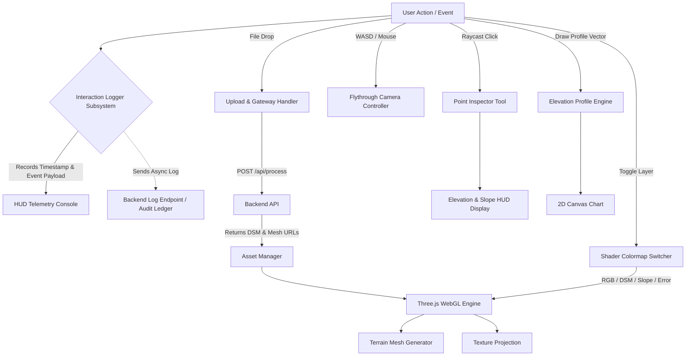

# DepthWizard Frontend Architecture & Design Plan (Phase 1)

This document details the Phase 1 Initial Planning, Visual Design Identity, and Architecture for the **DepthWizard Interactive 3D Visualization Platform**, adhering strictly to the `frontend-design` skill and the `/develop` engineering workflow.

---

## 1. Design System & Visual Identity (`frontend-design`)

### A. Subject & Vibe
* **Subject:** ISRO Tactical Disaster Reconnaissance & Elevation Intelligence Center.
* **Tone:** High-precision, scientific, dark tactical HUD interface, clean glassmorphism, responsive telemetry.

### B. Color Palette (Named Hex Tokens)
* **Background Deep Space:** `#0B0F19` (Obsidian Dark)
* **Panel Surface:** `rgba(15, 23, 42, 0.75)` (Glassmorphic Slate with `backdrop-filter: blur(12px)`)
* **Primary Metric Accent:** `#00F0FF` (Neon Topo Cyan)
* **Secondary Telemetry Accent:** `#FFB800` (Metric Amber)
* **Status Success:** `#10B981` (Sensor Emerald)
* **Error / Hazard:** `#FF453A` (Warning Crimson)

### C. Typography
* **Display / Eyebrows:** `Space Grotesk` (Tactical, geometric, authoritative)
* **Interface Body:** `Inter` (Legible, crisp UI elements)
* **Telemetry & Logs:** `JetBrains Mono` (Monospaced data streams and coordinate outputs)

### D. Signature Element
* **Tactical Telemetry & Interaction Logger HUD:** A real-time scrolling logger panel at the bottom right of the 3D viewport that records **every single user action** (clicks, camera WASD moves, layer toggles, raycast elevation queries, file uploads) with millisecond timestamps.

---

## 2. Requirement Analysis & Stack Adaptation
* **Core 3D Engine:** `Three.js` (WebGL Terrain displacement mesh with custom shaders for slope and elevation colormapping).
* **Control Mechanics:** `FlyControls` / WASD + Mouse PointerLock for FPS drone flight + `OrbitControls` for inspection.
* **Charts & Profile Plotter:** `Chart.js` / HTML5 Canvas for real-time 2D cross-section elevation profiles.
* **UI Architecture:** Modular Component-Driven Vanilla JS / ES Modules (no heavy framework overhead, ensuring 60 FPS WebGL rendering).

---

## 3. Visual & Structural Mapping

### Frontend Component Flowchart


### Logging Data Schema (JSON Schema for Interaction Logger)
```json
{
  "title": "UserInteractionLog",
  "type": "object",
  "properties": {
    "timestamp": { "type": "string", "format": "date-time" },
    "event_type": { 
      "type": "string", 
      "enum": ["UPLOAD_START", "UPLOAD_COMPLETE", "LAYER_SWITCH", "CAMERA_FLY", "POINT_INSPECT", "PROFILE_DRAW", "EXPORT_CLICK"] 
    },
    "component": { "type": "string" },
    "details": { "type": "object" }
  },
  "required": ["timestamp", "event_type", "component", "details"]
}
```

---

## 4. Resource & Hardware Profiling (Browser WebGL)
* **Target Frame Rate:** Locked **60 FPS** during 3D flythrough.
* **Mesh Resolution Limit:** Displacement grid capped at `256 x 256` vertices for real-time WebGL rendering on integrated GPUs, dynamically upscaled via smooth shading normals.
* **Memory Management:** Old textures and geometry buffers explicitly disposed (`geometry.dispose()`, `texture.dispose()`) when a new image is loaded to prevent browser WebGL context loss.

---

## 5. Threat & Failure Modeling (Unintended Consequences Report)

| Threat / Risk | Consequence | Mitigation Strategy |
| :--- | :--- | :--- |
| **WebGL Context Loss** | Browser crashes or renders a black screen on low-spec GPUs. | Add `webglcontextlost` event listener. Display fallback 2D elevation preview and provide a "Restore 3D View" recovery button. |
| **Log Buffer Overflow** | Rapid mouse moves or 60FPS camera moves flood memory with logs. | Throttle camera movement logging using `lodash.throttle` / 500ms sampling rate, while keeping discrete clicks instant. |
| **PointerLock Escape** | User loses flythrough control when pressing ESC. | Catch `pointerlockchange` events and display a visible overlay hint to re-engage flight mode. |
| **Missing Texture Load** | WebGL renders pure black mesh if RGB texture fails to load. | Fallback to a procedural wireframe shader preview until texture finishes loading. |

---

## 6. User Gate
Phase 1 complete. Awaiting user approval to proceed to **Phase 2 (Modular Documentation & Test Planning for Frontend)**.
